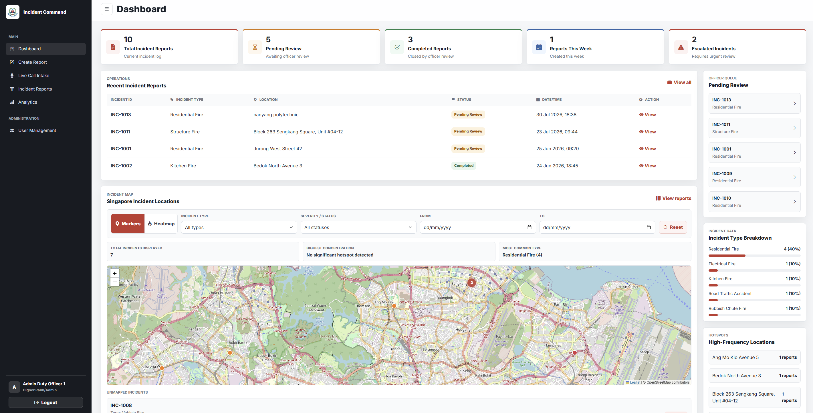
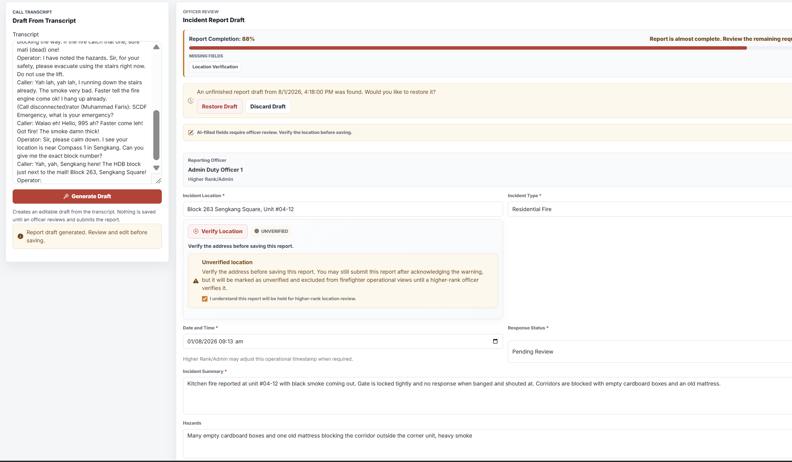
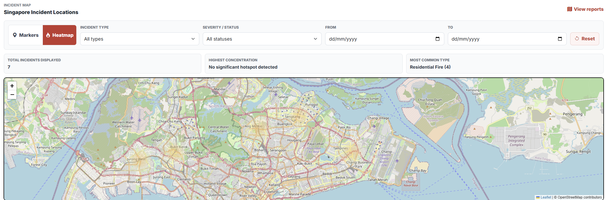
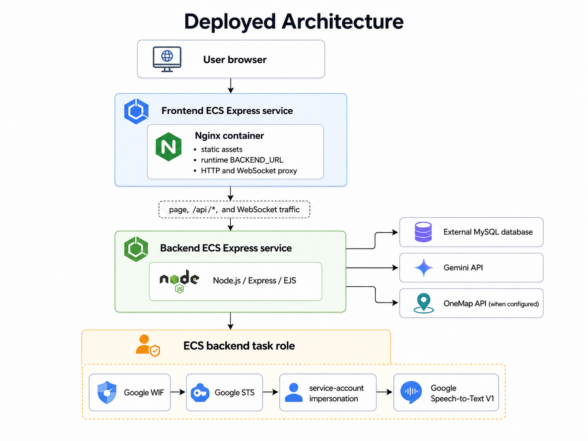
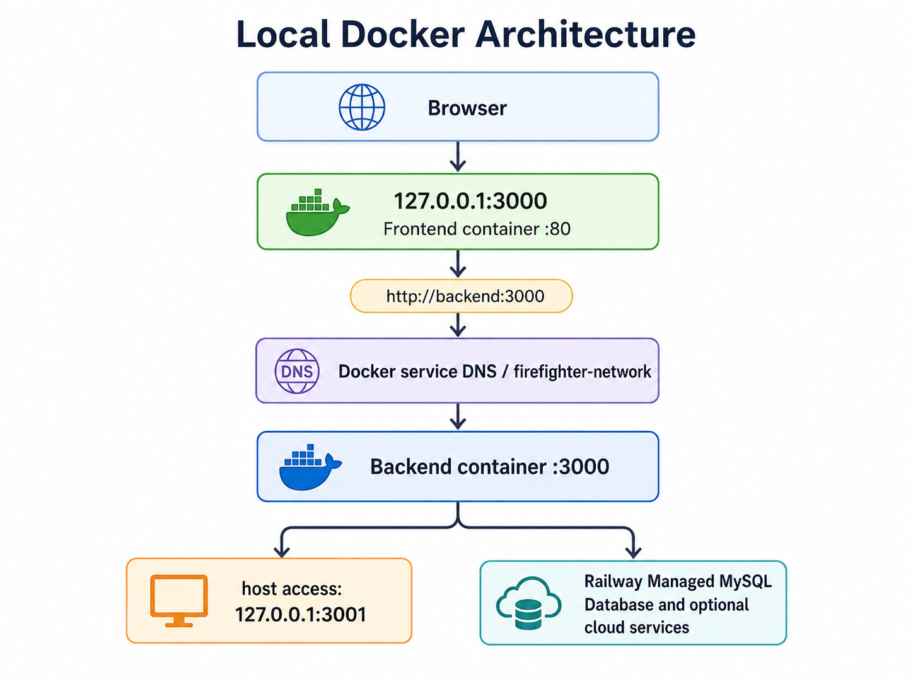

# Firefighter Smart Incident Dashboard

The Firefighter Smart Incident Dashboard is a Node.js incident-management platform for emergency-response teams. It combines operational reporting, geospatial intelligence, live voice transcription, and AI-assisted report drafting with a containerised AWS deployment pipeline.

## Live Deployed Application

[Open the Firefighter Smart Incident Dashboard](https://fi-6c256163a7464fe3b386b068e0bc31c6.ecs.ap-southeast-1.on.aws/dashboard)

This is the browser-facing application deployed on AWS ECS. Authentication is required to access the operational dashboard.

## Executive Summary

Emergency incident records can become incomplete, inconsistent, or difficult to review when responders must move quickly. This dashboard helps duty officers and supervisors capture calls, verify locations, prepare structured incident reports, monitor active incidents, and review operational trends from one authenticated interface.

The application is designed to improve:

- situational awareness through live incident maps and status summaries;
- incident-data quality through validation and officer review;
- reporting efficiency through voice transcription and editable AI-generated drafts;
- operational visibility through analytics, search, filters, and service diagnostics.

The primary users are duty officers who capture and review incidents, Higher Rank/Admin users who oversee report and location quality, and authorised personnel who manage accounts or inspect operational information according to their role.

## Application Preview

The screenshots below use demonstration incident data and show the main operational workflow without exposing credentials or cloud configuration.



*The operational dashboard combines verified demonstration incidents, officer-review queues, status summaries, and geospatial context in one authenticated view.*


*Live Call Intake supports streaming transcription, editable cleanup, manual fallback, and separate raw or cleaned transcript handoff to Create Report.*



*Using synthetic demonstration data, Gemini generated an editable draft while the officer acknowledged an unverified location. The report remains outside firefighter operational views until Higher Rank/Admin verification.*



*Verified demonstration incident locations support marker and heatmap views with operational filters; unverified reports remain outside firefighter-facing map data.*


*Analytics summarises reviewed incident data by type, status, and location to support situational awareness.*

## Key Features

### Incident Management

- Create, view, search, edit, and delete incident reports stored in MySQL.
- Track incident type, status, date and time, location, hazards, casualties, notes, and transcript evidence.
- Enforce mandatory report fields and server-trusted location verification. An explicitly acknowledged unverified report is held outside firefighter operational views until Higher Rank/Admin review.
- Preserve officer review: AI-generated content remains editable and is never saved automatically.
- Apply role-based permissions for duty officers, HR users, and higher-rank administrators.

### Geospatial Intelligence

- Display active incidents with Leaflet and OpenStreetMap tiles.
- Switch between clustered markers and an incident heatmap.
- Filter map data and show high-frequency location/type summaries.
- Keep verified but unmapped incidents visible for follow-up while excluding unverified locations from operational map and analytics data.
- Validate Singapore locations through the configured OneMap service, with repository-provided fallback location handling.

### AI-Assisted Reporting

- Clean raw call transcripts through the backend Gemini integration.
- Generate structured, editable incident-report drafts from reviewed transcript text.
- Validate Gemini's structured response before it reaches the browser.
- Use conservative manual fallbacks when AI is unavailable or returns an invalid response.

Gemini is called only by the backend. API credentials are not sent to the browser or built into either container image.

### Voice Transcription

- Capture browser microphone audio and stream PCM16 audio over WebSocket.
- Use Google Cloud Speech-to-Text V1 with `en-SG`, automatic punctuation, and interim results.
- Replace temporary interim text while preserving confirmed final transcript segments.
- Support non-streaming transcription and a manual transcript fallback.
- Keep the lightweight `/health` liveness route independent from external speech services; `/health/speech` performs the speech-specific diagnostic.

Local development uses Google Application Default Credentials (ADC). The ECS backend uses its temporary AWS task-role credentials with Google Workload Identity Federation (WIF), Google STS, and service-account impersonation. No Google private key is stored in the repository or image.

### Analytics and Operational Visibility

- Summarise incident totals and status/type/location distributions.
- Present incident trends and hotspot information.
- Show database, Gemini, and Google Speech service availability in the authenticated system-status view.
- Retain lightweight container liveness checks even when an external dependency is unavailable.

## Technology Stack

| Area | Current implementation |
|---|---|
| Backend | Node.js 22, Express, EJS, WebSocket (`ws`) |
| Browser UI | HTML, CSS, browser JavaScript, Leaflet, Leaflet.heat, Leaflet.markercluster |
| Frontend gateway | Nginx with runtime proxy configuration |
| Data | External MySQL-compatible database through `mysql2` |
| Authentication | Express sessions, bcrypt password hashing, role-based permissions |
| AI | Gemini through `@google/genai` |
| Speech | Google Cloud Speech-to-Text V1 through `@google-cloud/speech` |
| Maps and location | OpenStreetMap tiles, Leaflet, optional OneMap integration |
| Containers | Docker and Docker Compose |
| Delivery | GitHub Actions, Amazon ECR, Amazon ECS Express Mode, Ansible |
| DevSecOps | Gitleaks, Semgrep, `npm audit`, Trivy, GitHub OIDC |
| Gemini-Assisted Deployment Summary and Failure Diagnostics | Sanitized post-deployment summaries and failure explanations using Gemini |
| PR assistance | Optional CodeRabbit AI-assisted pull-request review |

## Deployed Architecture



*The browser-facing Nginx service proxies HTTP and WebSocket traffic to the backend, which uses external data and AI services; Google Speech authentication uses the backend ECS task role through Workload Identity Federation.*

```text
User browser
     |
     v
Frontend ECS Express service
Nginx container
  - static assets
  - runtime BACKEND_URL
  - HTTP and WebSocket proxy
     |
     | page, /api/*, and WebSocket traffic
     v
Backend ECS Express service
Node.js / Express / EJS
     |
     +----> External MySQL database
     +----> Gemini API
     +----> OneMap API (when configured)
     |
     +----> ECS backend task role
               |
               v
          Google WIF -> Google STS
               -> service-account impersonation
               -> Google Speech-to-Text V1
```

The frontend and backend run as separate images and separate ECS services. Nginx provides the browser-facing entry point and forwards dynamic page, API, and WebSocket traffic to the backend origin supplied through `BACKEND_URL`.

The repository deploys into existing AWS resources. It does not provision IAM roles, ECR repositories, ECS services, or networking. Those resources are managed externally; this repository automates image delivery and application rollout.

## Local Docker Architecture



*Docker Compose exposes the frontend on `127.0.0.1:3000`, routes internal traffic to `backend:3000`, and keeps the configured MySQL database external.*

```text
Browser
  |
  v
127.0.0.1:3000
Frontend container :80
  |
  | http://backend:3000
  v
Docker service DNS / firefighter-network
  |
  v
Backend container :3000
  |
  +---- host access: 127.0.0.1:3001
  +---- external MySQL and optional cloud services
```

The base Compose configuration provides:

- frontend access on host port `3000`;
- optional direct backend access on host port `3001`;
- backend service discovery through the Compose DNS name `backend`;
- a private bridge network for container-to-container traffic;
- health-aware frontend startup through `depends_on`;
- independent frontend and backend health checks;
- bounded shutdown grace periods and `restart: unless-stopped`;
- no database container—the configured MySQL database remains external.

An optional Compose overlay mounts an existing local Google ADC file read-only. It does not copy credentials into the repository or image. See [Docker Compose / Multi-container Orchestration](docs/FA-DOCKER-COMPOSE.md) for the detailed design and recovery demonstration.

## Container Architecture

### Frontend Container

The frontend image uses a digest-pinned Nginx Alpine base. It contains browser assets and an Nginx template that is rendered at container startup.

Key behavior:

- requires and validates an `http://` or `https://` `BACKEND_URL` origin;
- rejects credentials, paths, queries, fragments, whitespace, and invalid ports in that value;
- serves static assets and proxies pages and API calls to the backend;
- forwards WebSocket upgrade headers for live transcription;
- exposes a local JSON `/health` endpoint;
- sets response hardening headers and hides the Nginx version;
- includes a Docker health check.

See [Frontend Dockerisation](docs/FA-FRONTEND-DOCKER.md).

### Backend Container

The backend uses a two-stage, digest-pinned Docker build:

1. a Node.js 22 dependency stage runs `npm ci --omit=dev`;
2. a distroless Node.js 22 runtime receives only production dependencies and required application files.

The runtime:

- runs as non-root UID `65532`;
- contains no package manager or interactive shell;
- excludes tests, documentation, local configuration, and build-only files;
- exposes port `3000`;
- implements a lightweight Node-based Docker health check against `/health`;
- receives secrets and environment configuration only at runtime.

See [Backend Dockerisation](docs/FA-BACKEND-DOCKER.md).

## CI/CD Pipeline

The main workflow is [`.github/workflows/deploy.yml`](.github/workflows/deploy.yml).

```text
Pull request / push / manual run
              |
              v
Tests + production npm audit
Gitleaks
Semgrep
              |
              v
Build backend and frontend images
              |
              v
Trivy HIGH/CRITICAL image gates
              |
              v
Export exact scanned images + SHA-256 metadata
              |
       deployment eligible?
          /           \
        no             yes
   validation only      |
                        v
             GitHub OIDC -> AWS role
                        |
                        v
              Push SHA-tagged images to
              separate ECR repositories
                        |
                        v
              Register new task revisions
                        |
                        v
              Ansible backend-first rollout
                        |
                        v
              Pin exact backend service revision
              and new service-deployment ARN
                        |
                        v
              Wait for backend deployment state
              SUCCESSFUL, then verify /health
                        |
                        v
              Pin and wait for the exact frontend
              deployment, then run smoke verification
                        |
                        v
              Gemini Deployment Summary
```

Pipeline behavior:

- pull requests to `main` run tests, security checks, image builds, and image scans but cannot deploy;
- pushes to `main` deploy only after every required CI and security job succeeds;
- manual workflow runs default to scan-only unless deployment is explicitly enabled;
- AWS authentication occurs only in the deployment job;
- images are tagged with the Git commit SHA;
- the exact image archives scanned by Trivy are checksummed, transferred as artifacts, verified, and then pushed—deployment does not rebuild a different image;
- task-definition revisions are derived from active service definitions so existing runtime configuration, secrets, task roles, and execution roles are preserved.

ECS deployment state and Ansible's deterministic checks decide whether rollout succeeded. A service being `ACTIVE` is not sufficient: Ansible must correlate the requested task definition to the exact service revision and exact new service-deployment ARN, then observe that pinned deployment reach `SUCCESSFUL` before HTTP verification. The Gemini Deployment Summary runs afterward; it cannot deploy, roll back, modify AWS, or change the authoritative deployment result.

## DevSecOps Controls

| Control | Purpose | Deployment effect |
|---|---|---|
| `npm audit --omit=dev --audit-level=high` | Detect HIGH/CRITICAL production dependency vulnerabilities | Blocks the quality gate |
| Gitleaks | Scan repository content and history for secrets | Blocks the secret-scanning gate |
| Semgrep | Scan JavaScript with JavaScript and OWASP rules | Blocks the source-security gate |
| Trivy | Scan both container images for HIGH/CRITICAL OS and library vulnerabilities | Blocks image promotion |
| GitHub OIDC | Exchange the workflow identity for short-lived AWS role credentials | Removes the need for stored AWS access keys |
| Job-scoped permissions | Restrict OIDC and pull-request access to jobs that need them | Reduces workflow authority |

These controls run before production deployment. CodeRabbit is documented separately because it is review assistance, not an enforced security gate.

See [FA L4 DevSecOps Evidence](docs/FA-L4-DEVSECOPS.md) and [Security Policy](SECURITY.md).

## AWS Deployment

```text
GitHub Actions
      |
      | GitHub OIDC
      v
Existing GitHubActionsDeployRole
      |
      +----> Backend ECR repository
      +----> Frontend ECR repository
      |
      v
New backend/frontend task-definition revisions
      |
      v
Ansible
  -> request backend ECS service revision
  -> pin exact backend service revision
  -> pin exact new backend service-deployment ARN
  -> wait for authoritative SUCCESSFUL state
  -> backend /health
  -> request and pin exact frontend deployment
  -> wait for authoritative SUCCESSFUL state
  -> frontend smoke test
  -> verified rollback on failure
      |
      v
Isolated Gemini Deployment Summary
(no AWS, deployment, rollback, or remediation authority)
```

The deployment workflow:

- verifies that separate backend/frontend ECR repositories and ECS service ARNs are configured;
- pushes immutable commit-SHA image tags;
- discovers application container names from each active task definition;
- preserves existing ECS runtime environment, secret references, roles, and service configuration;
- registers new task-definition revisions in GitHub Actions;
- delegates rollout sequencing and verification to Ansible.

`GitHubActionsDeployRole` is manually managed in AWS IAM and is assumed through GitHub OIDC. If deployment resources change, its trust and least-privilege permissions must be updated in AWS IAM. The repository does not create or recreate that role.

## Ansible Deployment Automation

GitHub Actions and Ansible have separate responsibilities:

| GitHub Actions | Ansible |
|---|---|
| Run CI and security gates | Validate deployment preconditions |
| Build, scan, and publish images | Roll out the backend first |
| Authenticate to AWS through OIDC | Wait for the exact backend service deployment to become `SUCCESSFUL` |
| Inspect active task definitions | Verify backend `/health` |
| Register new task-definition revisions | Roll out and stabilize the frontend |
| Supply immutable revision inputs | Run the frontend smoke test |
| Publish workflow summaries/artifacts | Collect bounded diagnostics and perform verified rollback |

The Ansible role is idempotent: when a service already uses the requested task definition, the update is skipped while verification still runs. For each update, it correlates the requested task definition to the exact ECS service revision and exact new service-deployment ARN, polls that pinned deployment until its authoritative state is `SUCCESSFUL`, and only then performs backend health or frontend smoke verification. Stabilization and HTTP retries are bounded. If a rollout fails, the role preserves the original error, gathers non-secret service diagnostics, requests the previous task revisions, verifies rollback state, and reports both the deployment and rollback outcomes.

See [Ansible ECS Express Deployment](docs/FA-ANSIBLE-CLOUD-DEPLOYMENT.md).

## Gemini-Assisted Deployment Summary and Failure Diagnostics

Google Gemini receives bounded, structured deployment evidence after a completed
deployment job. After successful deployment and health checks, it produces a
concise result summary. When deployment fails, it explains the likely issue and
suggests troubleshooting checks based on sanitized workflow and Ansible
diagnostics.

```text
Completed Ansible/ECS deployment
          |
          v
Allowlisted and sanitized diagnostics
          |
          v
Isolated Gemini analysis job
          |
          v
Gemini structured analysis
          |
          v
GitHub Actions Summary
          |
          v
Risk-based human-review result
```

Safety boundaries include:

- allowlisting before redaction;
- bounded individual strings and total payload size;
- a dedicated `DEPLOYMENT_GEMINI_API_KEY`, separate from the application's Gemini credential;
- model-response schema validation and validated evidence paths;
- mandatory human review for failures and any successful deployment warning;
- no AWS credentials, OIDC permission, AWS API access, Ansible execution, command execution, rollback authority, or automatic remediation in the analysis job;
- preserved deployment failure semantics even if analysis succeeds.

### Local Simulation

```powershell
npm run gemini:deployment:demo
```

This uses synthetic failure data and a mocked Gemini client. It performs no AWS, Google, or other network operation.

### GitHub Actions FA Demonstration

Every completed deployment runs the isolated Gemini Deployment Summary job. A successful all-pass deployment is reported as `HEALTHY_DEPLOYMENT / LOW`, while a real failure retains its failure classification, rollback evidence, and mandatory human review. If Gemini is unavailable, deterministic sanitized evidence produces an explicitly labelled fallback summary.

For an integrated presentation, manually run `DevSecOps CI/CD` with `run_gemini_deployment_demo=true`. The workflow runs every normal gate, deploys and verifies AWS normally, writes the real success assessment, then adds clearly labelled synthetic failure evidence. The summary keeps the real deployment `SUCCESS` separate from the synthetic scenario `FAILED`. The Gemini analysis job still has only `contents: read` and no AWS, OIDC, deployment, rollback, or remediation authority.

The standalone `Gemini Deployment Demo` workflow remains available when a deployment is not required. Both demonstration paths use live Gemini when the dedicated secret is available and a schema-validated mocked fallback otherwise.

### Production Assessment Paths

The production Gemini analysis job runs when the deploy job finishes with `success` or `failure`. It receives only a bounded sanitized artifact. Failed CI/security gates leave deployment skipped, so they cannot trigger deployment or a misleading deployment assessment. Gemini remains advisory and cannot change a successful deployment, failed deployment, or rollback result.

This is an advisory Gemini feature, not an autonomous operations platform.
Gemini summarises successful deployment results, assists with failure
diagnostics, and suggests possible causes and troubleshooting actions.
Deployment decisions, monitoring, validation, rollback, and infrastructure
operations remain deterministic and controlled by GitHub Actions, Ansible,
Amazon ECS, and the existing AWS services. Gemini does not deploy, monitor,
roll back, repair, approve releases, or guarantee that its diagnosis is correct.

The repository implementation proves the guarded workflow and simulation paths; it does not by itself prove that a real failed ECS rollout has already completed live Gemini analysis. See [Gemini-Assisted Deployment Summary and Failure Diagnostics](docs/FA-GEMINI-DEPLOYMENT-SUMMARY-AND-DIAGNOSTICS.md).

### Verified production deployment evidence

The normal deployment for commit [`0fa36fc`](https://github.com/25044598ShawnTayYaoTiing/C270-firefighter-dashboard/commit/0fa36fc6ccf664479fac232bb4358fe25cde68b5) was verified in [GitHub Actions run 30708343101](https://github.com/25044598ShawnTayYaoTiing/C270-firefighter-dashboard/actions/runs/30708343101).

Authoritative deployment result:

- Deployment outcome: `SUCCESS`
- ECS stabilization: `PASS`
- Backend health: `PASS` (`/health` returned HTTP 200 and `{"status":"ok"}`)
- Frontend smoke test: `PASS` (HTTP 200)
- Rollback: not required
- Backend task definition: `default-firefighter-backend:45`
- Frontend task definition: `default-firefighter-frontend:36`
- Backend and frontend images: tagged with the full commit SHA `0fa36fc6ccf664479fac232bb4358fe25cde68b5`
- Recorded deployment duration: 1,215 seconds

Gemini summary validation status:

- Live Gemini request: attempted and returned successfully
- Model: `gemini-3.5-flash-lite`
- Structured validation: `PASS`
- Evidence validation: `FAIL` because the response omitted required evidence `E6`
- Corrective evidence retry: attempted once
- Official assessment source: `DETERMINISTIC FALLBACK`
- Classification retained by the deterministic success assessment: `HEALTHY_DEPLOYMENT`
- Risk level: `LOW`

This demonstrates the intended boundary: ECS, Ansible, health checks, smoke tests,
and rollback results remain authoritative. Gemini can summarise the deployment, but
an unvalidated response cannot be presented as the official assessment or change the
deployment result.

## Optional CodeRabbit Review

The root [`.coderabbit.yaml`](.coderabbit.yaml) configures concise automatic pull-request reviews focused on:

- correctness and regression risk;
- security and data-integrity defects;
- reliability and missing validation;
- Docker, Compose, GitHub Actions, AWS deployment, and Ansible risks;
- Gemini analysis trust boundaries and maintainability.

Style-only feedback is intentionally de-emphasized. CodeRabbit requires its GitHub App to be installed and authorized for the repository; the configuration file alone does not run reviews. It is not part of deployment analysis, an enforced scanner, or a replacement for Gitleaks, Semgrep, `npm audit`, or Trivy.

## Local Setup

### Prerequisites

- Node.js 22 and npm
- access to a MySQL-compatible database
- Docker Desktop with Docker Compose for container workflows
- optional: Google Cloud CLI with local ADC for Speech-to-Text
- optional: Gemini and OneMap credentials for their respective features

### 1. Configure the Environment

Copy the example file and fill in your own local values:

```powershell
Copy-Item .env.example .env
```

On macOS or Linux:

```bash
cp .env.example .env
```

At minimum, configure a strong `SESSION_SECRET` and the `DB_HOST`, `DB_PORT`, `DB_USER`, `DB_PASSWORD`, and `DB_NAME` values needed for the external database. Leave optional service credentials blank when those integrations are not being tested.

Never commit `.env`, ADC files, API keys, database passwords, session secrets, or cloud credentials.

### 2. Install and Test

```powershell
npm ci
npm test
```

If the database needs the repository's demonstration schema/data:

```powershell
npm run seed
npm run seed:users
```

Use only non-production data for local demonstrations.

The incident model applies a non-destructive compatibility migration when it first accesses an existing database. It adds one `location_verification_status` column with the states `VERIFIED` and `UNVERIFIED`. Existing non-draft records default to `VERIFIED` so currently displayed operational reports remain visible; existing drafts are marked `UNVERIFIED` because they were not yet officer-complete. New writes always store an explicit state, and no database reset is required. The seed command creates and populates the same column.

### 3. Start the Node Application

```powershell
npm start
```

The default direct-development URL is `http://localhost:3000`. The complete application requires a reachable database; Gemini, Speech-to-Text, and OneMap remain optional integrations with safe fallback behavior where implemented.

### 4. Optional Local Speech ADC

Authenticate locally without creating a service-account key:

```powershell
gcloud auth application-default login
```

Set `GOOGLE_CLOUD_PROJECT` in `.env`. Direct Node.js development resolves ADC automatically; `GOOGLE_APPLICATION_CREDENTIALS` is not required for the normal host-based local flow.

## Docker Compose Startup

After creating `.env`:

```powershell
docker compose up -d --build
```

Open:

- frontend gateway: `http://localhost:3000`
- direct backend health: `http://localhost:3001/health`

Stop the stack with:

```powershell
docker compose down
```

### Optional ADC Overlay

After `gcloud auth application-default login`, point the overlay at the existing host ADC file:

```powershell
$env:GOOGLE_APPLICATION_CREDENTIALS_HOST="$env:APPDATA\gcloud\application_default_credentials.json"
docker compose -f docker-compose.yml -f docker-compose.gcp.yml up -d --build
```

The overlay mounts that file read-only at runtime. It is not copied into either image.

## Validation & Testing

| Command | What it validates |
|---|---|
| `npm test` | Full Node.js unit and integration-style test suite with external services mocked where appropriate |
| `npm audit --omit=dev --audit-level=high` | Production dependency HIGH/CRITICAL vulnerability gate |
| `npm run frontend:container-test` | Frontend image configuration, proxy, health, failure, and recovery behavior |
| `npm run compose:smoke` | Two-container build, service DNS, proxying, health ordering, failure, and recovery |
| `npm run gemini:deployment:demo` | Local synthetic diagnostics sanitization, schema validation, and Gemini analysis authority boundary |
| `docker compose config --quiet` | Resolved Compose configuration after required `.env` values are present |

Docker-based checks require a running Docker engine. Cloud deployment is intentionally not part of local README validation.

## Environment and Configuration

Use [`.env.example`](.env.example) as the local configuration reference.

### Local Application and Compose

| Category | Variables |
|---|---|
| Runtime | `NODE_ENV`, `FRONTEND_PORT`, `BACKEND_PORT`, `CORS_ORIGIN`, `SESSION_SECRET`, `SESSION_COOKIE_NAME` |
| Database | `DB_HOST`, `DB_PORT`, `DB_USER`, `DB_PASSWORD`, `DB_NAME` |
| Gemini | `GEMINI_API_KEY`, `GEMINI_MODEL`, `GEMINI_TIMEOUT_MS` |
| Speech | `GOOGLE_CLOUD_PROJECT`, optional local-overlay `GOOGLE_APPLICATION_CREDENTIALS_HOST` |
| Location | `ONEMAP_EMAIL`, `ONEMAP_PASSWORD`, `ONEMAP_BASE_URL`, `GEOCODING_DEBUG` |

`BACKEND_URL` is the frontend image's runtime contract. The base Compose file deliberately sets it to `http://backend:3000` so traffic uses Docker service discovery.

### GitHub Repository Variables

Production deployment expects:

- `AWS_REGION`
- `AWS_ROLE_TO_ASSUME`
- `ECR_BACKEND_REPOSITORY`
- `ECR_FRONTEND_REPOSITORY`
- `ECS_BACKEND_SERVICE_ARN`
- `ECS_FRONTEND_SERVICE_ARN`
- `APP_HEALTH_URL`
- `APP_SMOKE_URL`
- optional `DEPLOYMENT_GEMINI_MODEL`

`DEPLOYMENT_GEMINI_MODEL` selects the model used only by the deployment-summary
and failure-diagnostics workflows.

### GitHub Repository Secrets

- `DEPLOYMENT_GEMINI_API_KEY` is available only to the Gemini summary, failure-diagnostics, and demo steps that need it.

The application `GEMINI_API_KEY`, database credentials, and session secret remain ECS runtime configuration. The workflow preserves those settings from active task definitions rather than receiving them as Docker build arguments.

### ECS Runtime

- frontend: a valid backend service origin through `BACKEND_URL`;
- backend: application/database variables, optional Gemini and OneMap configuration, `GOOGLE_CLOUD_PROJECT`, `GOOGLE_AUTH_MODE=aws-wif`, and the expected AWS region;
- speech authentication: temporary credentials supplied automatically by the backend ECS task role, not static credential variables.

## Security Notes

- The backend runs as a non-root user in a minimal distroless image.
- Base container images are pinned by digest.
- The frontend validates `BACKEND_URL` before Nginx starts and emits hardening headers.
- Production requires an explicit session secret; cookies are HTTP-only, same-site, and secure in production.
- The optional local ADC mount is read-only and stays outside the build context.
- `.env`, key files, logs, and generated diagnostic artifacts are ignored by Git.
- Gitleaks, Semgrep, production `npm audit`, and Trivy run before deployment.
- GitHub OIDC supplies short-lived AWS credentials only to the deployment job.
- Google WIF uses temporary ECS task-role credentials; no Google service-account private key is required.
- The Gemini analysis job receives sanitized operational data and has no cloud or remediation authority.

These controls reduce risk but do not replace external IAM review, secret rotation, database security, network controls, or operational monitoring.

## Repository Structure

```text
.github/
  workflows/             CI/CD and manual Gemini deployment-analysis workflows
ansible/                 ECS Express rollout, verification, diagnostics, rollback
config/                  Application and database configuration
controllers/             HTTP request handling
docs/                    Detailed FA implementation and evidence guides
frontend/                Nginx image, proxy template, runtime URL validation
helpers/                 Location and incident mapping helpers
middleware/              Authentication and role-based authorization
models/                  MySQL data access
public/                  Browser JavaScript, CSS, and static assets
routes/                  Page and API route definitions
scripts/
  deployment-analysis/   Diagnostics sanitizer, analyzer, and safe simulations
services/                Gemini, Speech-to-Text, WIF, and WebSocket services
test/                    Automated regression and infrastructure-config tests
views/                   EJS page templates
Dockerfile               Backend multi-stage distroless image
docker-compose.yml       Local frontend/backend orchestration
docker-compose.gcp.yml   Optional read-only local ADC overlay
package.json             Node.js dependencies and validation scripts
SECURITY.md              Security and credential-handling guidance
```

## FA DevOps Implementation

| Area | Implementation |
|---|---|
| CI/CD | Gated GitHub Actions pipeline |
| Frontend Dockerisation | Digest-pinned Nginx container with runtime proxy validation |
| Backend Dockerisation | Multi-stage, distroless, non-root Node.js container |
| Multi-container orchestration | Health-aware Docker Compose topology and recovery smoke test |
| Cloud deployment | Separate backend/frontend images in Amazon ECR and services in ECS Express Mode |
| Deployment automation | Idempotent, backend-first Ansible rollout with verification and rollback |
| DevSecOps | Gitleaks, Semgrep, production `npm audit`, Trivy, and least-privilege OIDC workflow controls |
| Gemini-Assisted Deployment Summary and Failure Diagnostics | Sanitized success summaries and failure explanations with human troubleshooting suggestions |
| AI-assisted review | Optional CodeRabbit pull-request review configuration |

Together, these components demonstrate automated validation, immutable container promotion, short-lived cloud authentication, deterministic deployment, failure recovery, and security controls integrated before release.

Detailed individual ownership, shared-file boundaries, and presentation evidence are documented in the [FA DevOps Team Responsibility Map](docs/FA-TEAM-RESPONSIBILITY-MAP.md).

## Documentation

- [Frontend Dockerisation](docs/FA-FRONTEND-DOCKER.md)
- [Backend Dockerisation](docs/FA-BACKEND-DOCKER.md)
- [Docker Compose / Multi-container Orchestration](docs/FA-DOCKER-COMPOSE.md)
- [Ansible ECS Express Deployment](docs/FA-ANSIBLE-CLOUD-DEPLOYMENT.md)
- [FA L4 DevSecOps Evidence](docs/FA-L4-DEVSECOPS.md)
- [Gemini-Assisted Deployment Summary and Failure Diagnostics](docs/FA-GEMINI-DEPLOYMENT-SUMMARY-AND-DIAGNOSTICS.md)
- [FA DevOps Evidence Guide](docs/FA-DEVOPS-EVIDENCE-GUIDE.md)
- [FA DevOps Team Responsibility Map](docs/FA-TEAM-RESPONSIBILITY-MAP.md)
- [Security Policy](SECURITY.md)

## Scope and External Dependencies

- AWS IAM, ECR repositories, ECS Express services, networking, and runtime secret stores are existing external resources and are not provisioned by this repository.
- The application requires an externally reachable MySQL-compatible database for full functionality.
- Gemini, Google Speech-to-Text, OneMap, AWS, and GitHub App behavior depends on external accounts, permissions, quotas, configuration, and service availability.
- CodeRabbit reviews require separate GitHub App installation/authorization.
- Gemini recommendations are probabilistic and advisory; deterministic deployment checks and human review remain authoritative.
