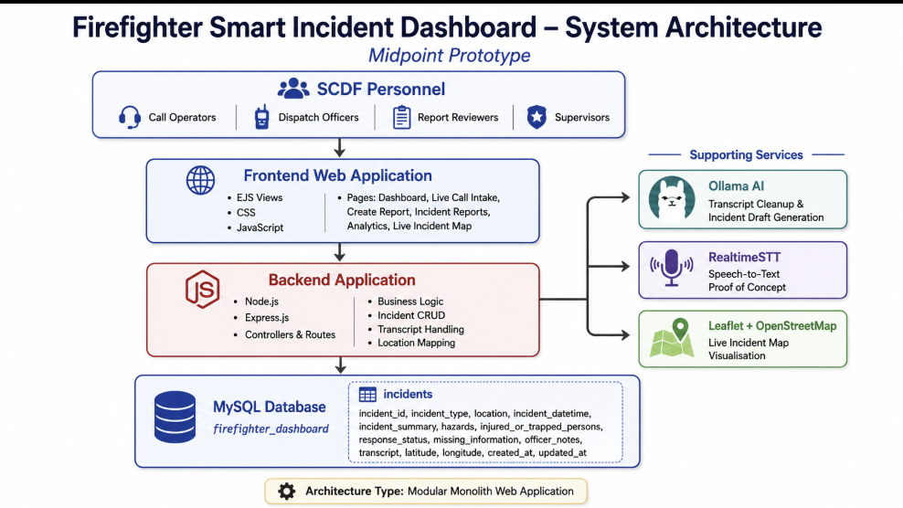
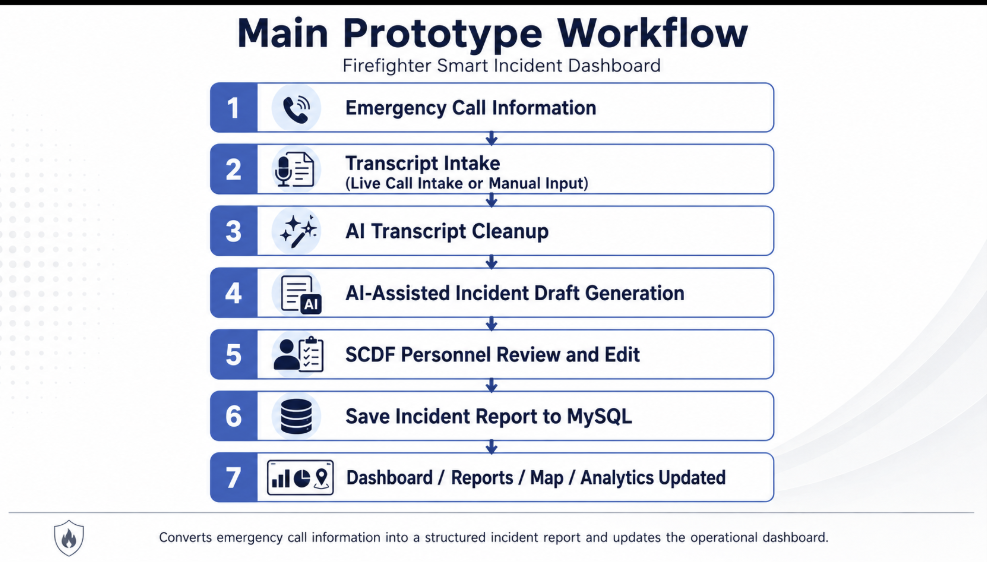
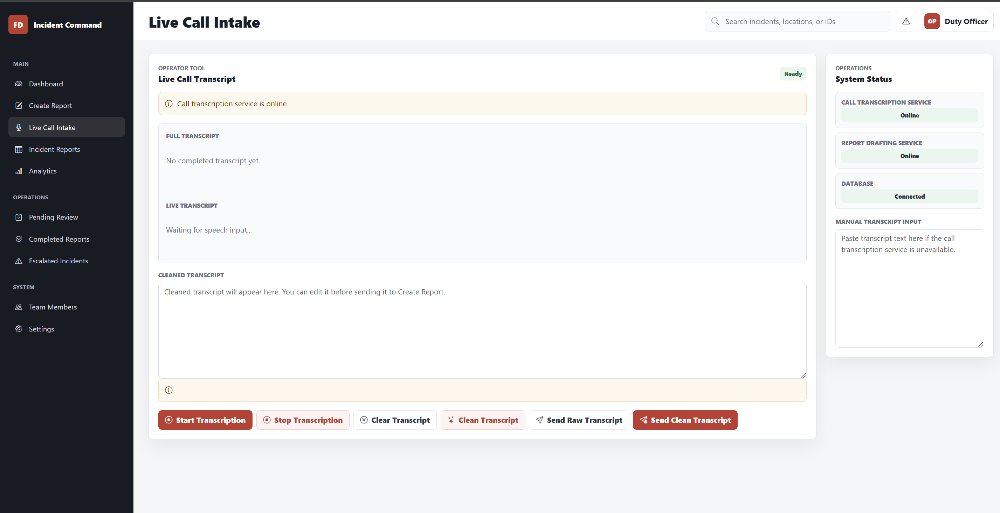
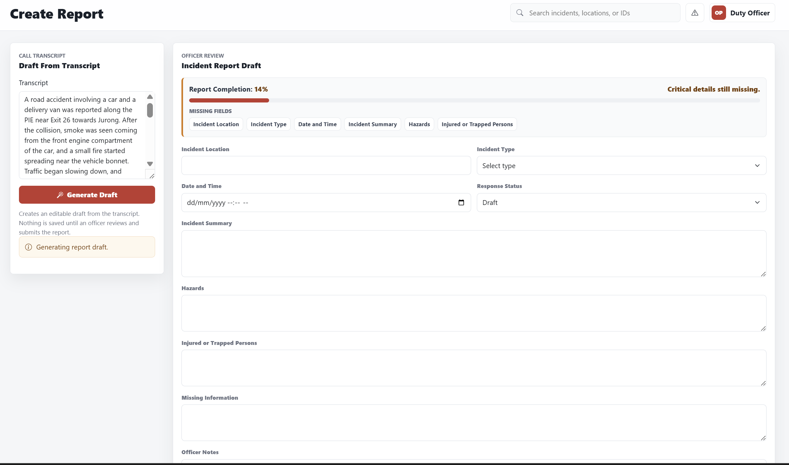
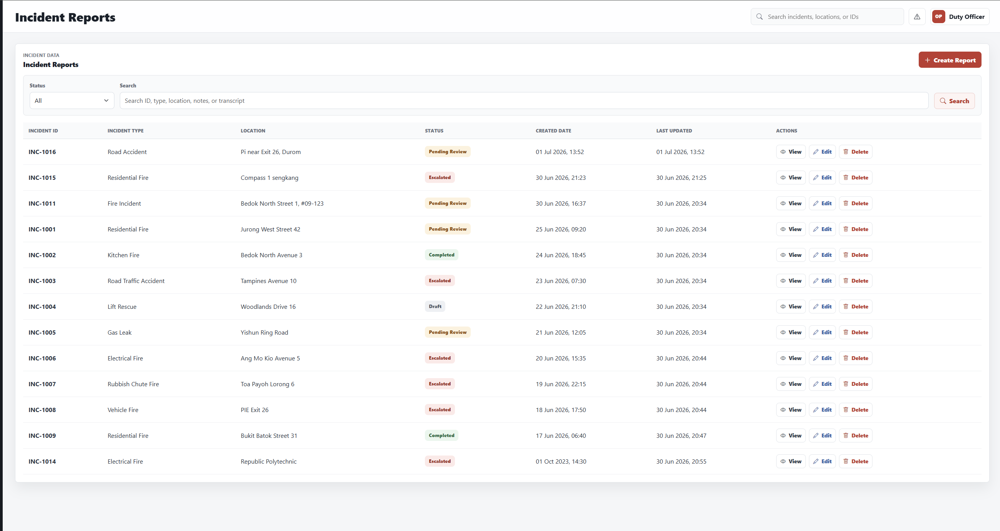
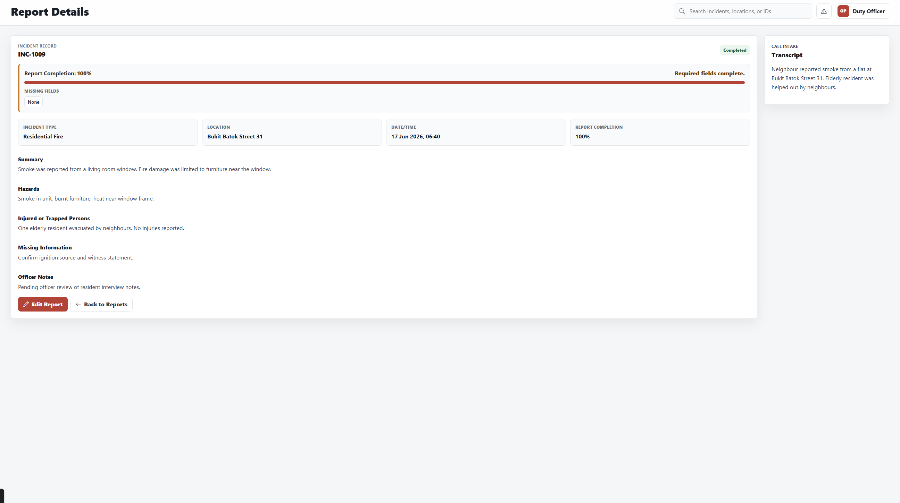
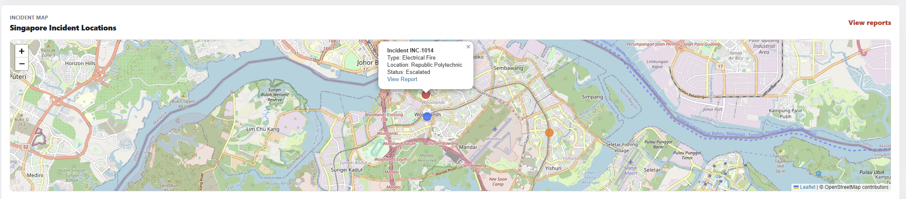
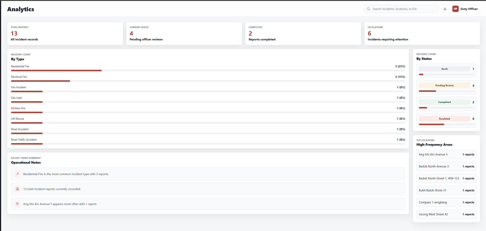

# Firefighter Smart Incident Dashboard

## Overview

The Firefighter Smart Incident Dashboard is a web-based incident reporting prototype for SCDF personnel. It helps users capture emergency call information, clean raw transcripts, generate AI-assisted incident report drafts, review and edit report details, save reports to MySQL, and monitor operational records through dashboard, reports, map, and analytics pages.

The project uses Node.js, Express.js, EJS, CSS, JavaScript, MySQL, Ollama, RealtimeSTT, Leaflet, and OpenStreetMap.

## Problem Statement

Emergency incident reporting can be time-consuming when important details are captured manually. SCDF personnel need to record location, incident type, hazards, injured or trapped persons, response status, missing information, and officer notes. Missing or unclear details can slow down report review, documentation, and follow-up action.

This prototype reduces manual effort by supporting transcript intake, AI-assisted cleanup, AI-assisted draft generation, structured review, searchable MySQL storage, and live operational summaries.

## Target Users

- SCDF emergency call operators
- Dispatch officers
- Incident report reviewers
- Fire and rescue supervisors
- Operations team members

## System Architecture



The application uses a modular monolith structure. The Node.js / Express backend renders EJS pages, handles report routes, calls local AI services, and reads/writes incident records in MySQL.

```text
SCDF Personnel
-> Frontend Web Application using EJS, CSS, and JavaScript
-> Backend Application using Node.js and Express.js
-> MySQL Database using firefighter_dashboard and incidents table
```

Supporting services:

- Ollama for AI transcript cleanup and AI-assisted incident draft generation
- RealtimeSTT for the live speech-to-text proof-of-concept
- Leaflet and OpenStreetMap for live incident map visualisation
- OneMap, when configured, for Singapore coordinate lookup

## Main Prototype Workflow



```text
Emergency Call Information
-> Transcript Intake
-> AI Transcript Cleanup
-> AI-Assisted Incident Draft
-> SCDF Personnel Review and Edit
-> Save Incident Report to MySQL
-> Dashboard / Reports / Map / Analytics Updated
```

## Features

### Dashboard Overview

The dashboard summarises current incident reporting activity using cards for:

- All Incident Records
- Awaiting Officer Review
- Reviewed Reports
- Urgent / Escalated Incidents
- New Reports This Week

Dashboard values are recalculated from MySQL whenever the page reloads. The database does not currently store response time, so the dashboard uses reports created this week instead of an average response-time metric.

### Live Call Intake



The Live Call Intake page supports a RealtimeSTT speech-to-text proof-of-concept and a manual transcript fallback. It includes:

- Live Transcript for the latest speech segment
- Full Transcript for committed transcript text
- Clean Transcript Text for AI-cleaned output
- Send Raw Transcript to move raw text into Create Report
- Send Clean Transcript to move reviewed cleaned text into Create Report

If RealtimeSTT is unavailable, users can paste transcript text manually.

### AI-Assisted Transcript Cleanup

Ollama helps clean raw transcript text for readability and clarity. The browser calls the Express backend, and the backend calls Ollama; the browser never calls Ollama directly.

### AI-Assisted Incident Drafting

Ollama helps generate editable incident fields from a transcript, including:

- Incident type
- Location
- Summary
- Hazards
- Injured or trapped persons
- Missing information
- Officer notes
- Response status

AI drafts must be reviewed by SCDF personnel before saving. If Ollama is unavailable, the app keeps manual editing available and can return a conservative fallback draft.

### Incident Report CRUD







The dashboard keeps MySQL-backed incident report management:

- Create report
- View report
- Edit report
- Delete report
- Search reports
- Filter reports by status

Report completion appears on Create Report, Edit Report, and Report Details. Completion is based on incident location, incident type, date and time, summary, response status, hazards, and injured or trapped persons. The progress bar is advisory only and does not block the existing MySQL save flow.

### Live Incident Map



The Dashboard includes a Live Incident Map built with Leaflet and OpenStreetMap. It uses current MySQL incident rows and does not rely on hardcoded sample markers.

Map rules:

- Incidents appear only when they have finite `latitude` and `longitude` values.
- Escalated or urgent incidents are red.
- Pending or awaiting review incidents are orange.
- Active, ongoing, dispatched, or in-progress incidents are blue.
- Completed, reviewed, closed, or resolved reports are hidden from the live map.
- Live incidents without usable coordinates appear under Unmapped Incidents.

Coordinate resolution order:

1. Existing valid latitude and longitude.
2. OneMap Search API, when `ONEMAP_EMAIL` and `ONEMAP_PASSWORD` are configured.
3. Local Singapore fallback matching from location, transcript, or summary.
4. `null` if no match is found.

To backfill old reports that are missing coordinates:

```powershell
node scripts/backfillIncidentCoordinates.js
```

For backend-only map payload debugging in non-production:

```text
GET /dev/map-payload
```

When `GEOCODING_DEBUG=true`, dashboard rendering logs map payload counts to the Node.js console. OneMap email, password, and access tokens are never sent to EJS or frontend JavaScript.

### Analytics



Analytics values are recalculated from MySQL and show:

- Incident type distribution
- Response status overview
- High-frequency locations
- Pending review count
- Reviewed report count
- Escalated incident count
- Reports created this week

Percentages are calculated as `group count / total report count`.

### Search and Filtering

Search uses backend MySQL `LIKE` queries with parameters. It checks:

- Incident ID
- Incident Type
- Location
- Status
- Incident Summary
- Hazards
- Injured or Trapped Persons
- Missing Information
- Officer Notes
- Transcript

Search routes:

```text
GET /incidents?search=smoke
GET /incidents?status=Completed&search=vehicle
GET /api/incidents?search=smoke
GET /api/incidents?status=Completed&search=vehicle
```

## Technology Stack

| Area | Technology |
|---|---|
| Frontend | EJS, CSS, JavaScript |
| Backend | Node.js, Express.js |
| Database | MySQL |
| AI | Ollama |
| Speech-to-Text | RealtimeSTT |
| Map | Leaflet + OpenStreetMap |
| Version Control | GitHub |

## Database Design

Database name: `firefighter_dashboard`

Main table: `incidents`

| Field | Purpose |
|---|---|
| id | Primary key |
| incident_id | Unique incident reference |
| incident_type | Type of emergency |
| location | Incident location |
| incident_datetime | Date and time of incident |
| incident_summary | Summary of the incident |
| hazards | Hazards at the scene |
| injured_or_trapped_persons | Injured or trapped person details |
| response_status | Current report status |
| missing_information | Information still required |
| officer_notes | Reviewing officer notes |
| transcript | Original call transcript |
| latitude | Map latitude |
| longitude | Map longitude |
| created_at | Record creation time |
| updated_at | Last updated time |

## Getting Started

Follow these steps when setting up the project from zero on Windows.

### Prerequisites

- Node.js and npm
- MySQL running locally or reachable from this machine
- Ollama installed for AI cleanup and report drafting
- PowerShell on Windows
- RealtimeSTT only if live speech-to-text is needed

### 1. Open the Project Folder

```powershell
cd C:\Users\goati\Downloads\firefighter-dashboard-prototype-fixed
```

### 2. Install Dependencies

```powershell
npm install
```

### 3. Set Up MySQL

Open MySQL, then create and select the project database:

```sql
CREATE DATABASE IF NOT EXISTS firefighter_dashboard;
USE firefighter_dashboard;
```

The `incidents` table must exist before the dashboard can save and load reports. Refer to the Database Design section for the expected table fields.

### 4. Create `.env`

Create `.env` in the project root:

```env
DB_HOST=localhost
DB_USER=root
DB_PASSWORD=your_password
DB_NAME=firefighter_dashboard
DB_PORT=3306

OLLAMA_HOST=http://localhost:11434
OLLAMA_MODEL=qwen2.5:1.5b

ONEMAP_EMAIL=
ONEMAP_PASSWORD=
ONEMAP_BASE_URL=https://www.onemap.gov.sg
GEOCODING_DEBUG=false
```

Replace `your_password` with your local MySQL password. OneMap credentials are optional; if they are blank, report creation, report editing, and coordinate backfill use the local Singapore fallback resolver. Do not commit `.env` or expose private credentials.

### 5. Start Ollama

```powershell
ollama pull qwen2.5:1.5b
ollama list
```

Ollama should be available at:

```text
http://localhost:11434/api/tags
```

### 6. Start the Dashboard Only

```powershell
npm start
```

Open:

```text
http://localhost:3000
```

RealtimeSTT is not required if you are using manual transcript input.

### 7. Seed Sample Reports

```powershell
npm run seed
```

### 8. Run RealtimeSTT Only If Live Speech-to-Text Is Needed

```powershell
cd C:\Users\goati\Downloads\RealtimeSTT
.\.venv-fastapi\Scripts\Activate.ps1
python example_fastapi_server\server.py --host 127.0.0.1 --port 8010 --engine faster_whisper --model medium.en --realtime-model tiny.en --language en
```

### 9. Run the Full Demo

```powershell
npm run demo
```

The demo launcher opens the dashboard and RealtimeSTT in separate PowerShell windows, opens the dashboard in your browser, and checks Ollama. It does not start MySQL or Ollama.

## Environment Variables

The dashboard reads local configuration from `.env`. Keep this file in the project root, keep it private, and never commit it.

| Variable | Purpose |
|---|---|
| `DB_HOST` | MySQL host, usually `localhost` |
| `DB_USER` | MySQL username |
| `DB_PASSWORD` | Local MySQL password |
| `DB_NAME` | Database name, `firefighter_dashboard` |
| `DB_PORT` | MySQL port, usually `3306` |
| `OLLAMA_HOST` | Ollama server URL |
| `OLLAMA_MODEL` | Local model used for cleanup and draft generation |
| `ONEMAP_EMAIL` | Optional OneMap email |
| `ONEMAP_PASSWORD` | Optional OneMap password |
| `ONEMAP_BASE_URL` | OneMap API base URL |
| `GEOCODING_DEBUG` | Enables backend map payload logging when `true` |

## Run the Full Local Demo

Use this flow when you want the dashboard and RealtimeSTT running together for a prototype demo. Ollama usually runs automatically in the background on Windows, so the script checks whether it is reachable instead of starting it.

1. Start MySQL first.
2. Confirm `.env` exists in the project root.
3. Run `npm install` if `node_modules` is missing.
4. Run the demo launcher:

   ```powershell
   npm run demo
   ```

The demo uses:

- Dashboard on `http://localhost:3000`
- RealtimeSTT on `http://127.0.0.1:8010`
- Ollama on `http://localhost:11434`
- MySQL on `localhost:3306`

The launcher opens separate PowerShell windows for the dashboard and RealtimeSTT, opens the dashboard in your browser, and checks the Ollama API at `http://localhost:11434/api/tags`. It does not start MySQL or Ollama.

By default, the script expects RealtimeSTT at:

```text
C:\Users\goati\Downloads\RealtimeSTT
```

If your RealtimeSTT folder is somewhere else, edit `$RealtimeSttPath` near the top of `scripts/start-demo.ps1`, then run `npm run demo` again. The script checks that the RealtimeSTT folder, `.venv-fastapi`, and `example_fastapi_server\server.py` exist before starting the service.

To stop the demo, close the separate PowerShell windows for the dashboard and RealtimeSTT.

## Recommended Demo Testing Flow

Use this flow to test the main prototype path end to end:

1. Start MySQL.
2. Start Ollama.
3. Run `npm install`.
4. Run `npm run seed`.
5. Run `npm start` or `npm run demo`.
6. Open `http://localhost:3000`.
7. Check the Dashboard cards.
8. Go to Live Call Intake.
9. Paste or capture a transcript.
10. Click Clean Transcript.
11. Send the transcript to Create Report.
12. Click Generate AI Report.
13. Review and edit the generated fields.
14. Save the report.
15. Check Incident Reports.
16. Refresh Dashboard, Map, and Analytics.

## Seed Sample Incident Reports

The dashboard and analytics read from the MySQL `incidents` table. To load realistic school-prototype data:

```powershell
npm run seed
```

The seed script inserts or refreshes 10 sample reports with IDs `INC-1001` through `INC-1010`, including residential fires, kitchen fire, road traffic accident, lift rescues, gas leak, electrical fire, rubbish chute fire, and vehicle fire. The script uses `ON DUPLICATE KEY UPDATE`, so running it again refreshes those same sample records instead of creating duplicates.

After seeding, open `http://localhost:3000/dashboard` and `http://localhost:3000/analytics` to confirm totals, charts, and percentages update.

## Run RealtimeSTT

RealtimeSTT is a separate Python service. Do not install it as a Node.js package.

1. Clone RealtimeSTT outside this dashboard project:

   ```powershell
   git clone https://github.com/KoljaB/RealtimeSTT.git
   cd RealtimeSTT
   ```

2. Create and activate a Python virtual environment:

   ```powershell
   python -m venv .venv-fastapi
   .\.venv-fastapi\Scripts\Activate.ps1
   ```

3. Upgrade packaging tools:

   ```powershell
   python -m pip install -U pip setuptools wheel
   ```

4. Install the main RealtimeSTT requirements:

   ```powershell
   python -m pip install -r requirements.txt
   ```

5. Install the FastAPI browser server requirements:

   ```powershell
   python -m pip install -r example_fastapi_server\requirements.txt
   ```

6. Start the FastAPI browser server on port `8010`:

   ```powershell
   python example_fastapi_server\server.py --host 0.0.0.0 --port 8010
   ```

7. Open the RealtimeSTT service directly if needed:

   ```text
   http://localhost:8010
   ```

The demo launcher uses this RealtimeSTT command:

```powershell
python example_fastapi_server\server.py --host 127.0.0.1 --port 8010 --engine faster_whisper --model medium.en --realtime-model tiny.en --language en
```

## Run Ollama

The dashboard calls Ollama from the Node.js backend. The browser never calls Ollama directly.

1. Install Ollama from:

   ```text
   https://ollama.com
   ```

2. Pull the local model:

   ```powershell
   ollama pull qwen2.5:1.5b
   ```

3. Confirm Ollama is running:

   ```powershell
   ollama list
   ```

4. Ollama should be available at:

   ```text
   http://localhost:11434/api/tags
   ```

## How Each Feature Works

### Live Call Intake Flow

Open `http://localhost:3000/transcription` or choose Live Call Intake from the sidebar.

1. To use live speech-to-text, start RealtimeSTT first and click Start Transcription.
2. Allow microphone access, then speak into the microphone.
3. RealtimeSTT converts speech to text through `ws://localhost:8010/ws/transcribe`.
4. Live Transcript updates with the latest speech segment.
5. Stop Transcription commits the latest text into Full Transcript.
6. Click Clean Transcript to send the transcript to Ollama for cleanup.
7. Click Send Raw Transcript or Send Clean Transcript to open Create Report with the transcript loaded.

If RealtimeSTT is unavailable, paste text into the manual transcript field and continue from the cleanup or send step.

### AI Report Flow

Open Create Report from the sidebar or send a transcript from Live Call Intake.

1. Confirm the Transcript field contains raw or cleaned call text.
2. Click Generate AI Report.
3. The backend sends the transcript to Ollama.
4. The form fills an editable AI-assisted incident draft.
5. Review and edit the generated fields.
6. Save the report with Save Draft or Save Report.

Backend AI endpoints:

```text
POST /api/ai/clean-transcript
POST /api/reports/generate
```

Both endpoints call Ollama at `OLLAMA_HOST` using `OLLAMA_MODEL`.

### Incident CRUD Flow

Use the report pages to manage MySQL-backed incident records:

1. Open Create Report to add a new incident.
2. Fill or generate the report fields.
3. Save the report to MySQL.
4. Open Incident Reports to view saved reports.
5. Use search or status filtering to find a report.
6. Open Report Details or Edit Report to review and update a report.
7. Delete a report only when it is no longer needed.
8. Refresh Dashboard and Analytics to see updated totals.

### Map Flow

Open Dashboard to view the Live Incident Map.

1. Create or edit a report with a clear incident location.
2. The backend resolves latitude and longitude when possible.
3. Coordinates are saved to MySQL.
4. The dashboard sends active incident map data to the browser.
5. Leaflet displays markers for incidents with valid coordinates.
6. Completed, reviewed, closed, and resolved reports are hidden from the live map.

### Analytics Flow

Open Analytics from the sidebar.

1. The backend reads current MySQL incident records.
2. It groups reports by type, status, and location.
3. It calculates totals and percentages.
4. The Analytics page displays the latest summary after refresh.

## Troubleshooting

### Port 8010 Already in Use

RealtimeSTT needs port `8010`. Find the process using the port:

```powershell
netstat -ano | findstr :8010
```

Stop the process by replacing `<PID_NUMBER>` with the PID from the last column:

```powershell
taskkill /PID <PID_NUMBER> /F
```

### Map Marker Does Not Appear

Check whether recent reports have coordinates:

```sql
SELECT incident_id, location, response_status, latitude, longitude
FROM incidents
ORDER BY id DESC
LIMIT 10;
```

Reports need valid `latitude` and `longitude` values to appear on the map. Completed, reviewed, closed, and resolved reports are intentionally hidden from the live map.

To backfill missing coordinates:

```powershell
node scripts/backfillIncidentCoordinates.js
```

### Dashboard Does Not Connect to MySQL

Confirm MySQL is running and that `.env` contains the correct `DB_HOST`, `DB_USER`, `DB_PASSWORD`, `DB_NAME`, and `DB_PORT`.

In MySQL, check the database and tables:

```sql
SHOW DATABASES;
USE firefighter_dashboard;
SHOW TABLES;
```

The demo script only checks whether MySQL is reachable; it does not start MySQL.

### Ollama Not Responding

Confirm Ollama is installed, the model is available, and the local service is running:

```powershell
ollama list
ollama pull qwen2.5:1.5b
```

Then check:

```text
http://localhost:11434/api/tags
```

If Ollama is unavailable, transcript cleanup and AI report generation may fail, but manual report editing remains available.

### RealtimeSTT Not Responding

Confirm RealtimeSTT is running on `http://localhost:8010` or `http://127.0.0.1:8010`. If the demo launcher cannot start it, check that the RealtimeSTT folder, `.venv-fastapi`, and `example_fastapi_server\server.py` exist.

Manual transcript input still works when RealtimeSTT is unavailable.

### Raw Transcript Does Not Send

Confirm there is text in Live Transcript, Full Transcript, Clean Transcript Text, or the manual transcript field before sending. Sent transcripts are stored in `localStorage`, then loaded into the Create Report transcript field.

### README Images Do Not Load

Check the image files and paths:

- Images must be inside `docs/images/`.
- README paths must match the file names exactly.
- Avoid spaces in image names.
- Use hyphens instead, for example `live-call-intake.png`.
- Check capitalization because GitHub paths are case-sensitive.

## Project Status

This is a midpoint prototype.

Completed:

- Dashboard overview
- Incident report CRUD
- MySQL storage
- AI-assisted report drafting
- Transcript cleanup
- Live Call Intake proof-of-concept
- Incident map
- Analytics summary
- Search and filtering
- GitHub version control

## Future Improvements

- Improve transcript accuracy
- Improve report validation
- Improve location mapping
- Add Docker containerisation
- Set up CI/CD pipeline
- Add testing and validation
- Prepare deployment workflow
