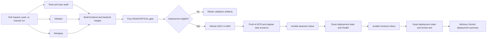

# Firefighter Smart Incident Dashboard

[](https://github.com/25044598ShawnTayYaoTiing/C270-firefighter-dashboard/actions/workflows/deploy.yml)

The Firefighter Smart Incident Dashboard is an authenticated emergency-response platform for capturing calls, validating locations, preparing incident reports, and reviewing operational trends. The application uses Node.js, Express, EJS, an external MySQL-compatible database, Gemini-assisted report drafting, and Google Speech-to-Text. It is delivered as separate frontend and backend containers through GitHub Actions, Amazon ECR, AWS ECS Express Mode, and a backend-first Ansible rollout.

**Live application:** [Open the deployed dashboard](https://fi-6c256163a7464fe3b386b068e0bc31c6.ecs.ap-southeast-1.on.aws/dashboard) — authentication is required.
Test Account: 
Highest Level: Admin1 password123
Low Level: Admin4 password123
## Contents

- [Application preview](#application-preview)
- [Project at a glance](#project-at-a-glance)
- [Key features](#key-features)
- [Architecture](#architecture)
- [DevOps implementation](#devops-implementation)
- [Local setup](#local-setup)
- [Docker Compose](#docker-compose)
- [Testing and validation](#testing-and-validation)
- [Environment configuration](#environment-configuration)
- [Security](#security)
- [Repository structure](#repository-structure)
- [Documentation](#documentation)
- [Scope and external dependencies](#scope-and-external-dependencies)
- [Team responsibilities](#team-responsibilities)

## Application preview

All screenshots use demonstration data.

| Operational dashboard | Live Call Intake |
|---|---|
|  |  |

| Gemini-assisted report draft | Incident heatmap |
|---|---|
|  |  |

## Project at a glance

| Area | Implementation |
|---|---|
| Application | Node.js 22, Express, EJS, browser JavaScript |
| Frontend gateway | Nginx |
| Database | External MySQL-compatible database through `mysql2` |
| Containers | Separate frontend and backend images |
| Local orchestration | Docker Compose |
| Cloud deployment | Amazon ECR and AWS ECS Express Mode |
| CI/CD | GitHub Actions |
| Deployment automation | Ansible |
| Security scanning | Gitleaks, Semgrep, `npm audit`, Trivy |
| Cloud authentication | GitHub OIDC with short-lived AWS credentials |
| AI reporting | Gemini through `@google/genai` |
| Speech transcription | Google Speech-to-Text V1 |

## Key features

### Incident management

- Create, view, search, edit, and delete incident reports.
- Capture incident type, status, time, location, hazards, casualties, notes, and transcript evidence.
- Hold acknowledged but unverified locations for Higher Rank/Admin review instead of exposing them in firefighter operational views.

### Location validation and geospatial intelligence

- Validate Singapore locations through OneMap when configured.
- Display verified incidents as clustered markers or a Leaflet heatmap.
- Filter map data by incident type, status, and date.

### AI-assisted report drafting

- Clean call transcripts and generate structured, editable incident-report drafts with Gemini.
- Validate structured responses before they reach the browser.
- Keep officer review authoritative; generated content is never saved automatically.

### Live voice transcription

- Stream browser microphone audio over WebSocket to the backend.
- Use Google Speech-to-Text V1 with `en-SG`, punctuation, and interim results.
- Preserve final transcript segments while replacing interim text, with manual entry available as a fallback.

### Analytics and operational visibility

- Summarise incident totals, statuses, types, trends, and high-frequency locations.
- Provide authenticated service status without making the lightweight `/health` liveness route depend on external services.

### Authentication and role-based access

- Use Express sessions and bcrypt password hashing.
- Apply permission checks for Duty Officer, HR, and Higher Rank/Admin responsibilities.

## Architecture

### Deployed architecture


The browser reaches a frontend ECS Express service running Nginx. Nginx proxies pages, `/api/*`, and WebSocket traffic to the backend ECS Express service using its runtime `BACKEND_URL`. The Node.js backend connects to the external database and optional Gemini and OneMap services. For Speech-to-Text in ECS, the backend exchanges temporary ECS task-role credentials through Google Workload Identity Federation (WIF), Google STS, and service-account impersonation; no Google private key is stored in the repository or image.

### Local Docker Compose architecture


Docker Compose exposes Nginx on `127.0.0.1:3000` and the backend on `127.0.0.1:3001`. Internal frontend-to-backend traffic uses Docker service discovery at `http://backend:3000`. The database remains external.

## DevOps implementation



| Component | Responsibility |
|---|---|
| GitHub Actions | Runs tests and security gates, builds and scans both images, authenticates with OIDC, publishes commit-SHA images to separate ECR repositories, registers task-definition revisions, and orchestrates the release. |
| Docker and Compose | Build digest-pinned frontend and backend images and provide health-aware local service discovery. The backend image is multi-stage, distroless, and non-root. |
| Ansible | Performs preflight checks, deploys the backend first, pins the exact ECS service revision and deployment, waits for authoritative completion, verifies `/health`, deploys the frontend, runs the smoke test, gathers diagnostics, and verifies rollback when required. |
| Gemini deployment assistance | Receives bounded, allowlisted, sanitised evidence after a completed deployment and produces an advisory success summary or failure-diagnostic suggestions. It cannot access AWS, deploy, roll back, approve a release, or remediate a failure. |

The main [DevSecOps CI/CD workflow](.github/workflows/deploy.yml) runs validation on pull requests to `main`. Pushes to `main` deploy only after all required jobs pass. Manual runs default to validation-only; deployment-related inputs must be explicitly enabled. The exact images scanned by Trivy are checksummed and transferred as artifacts before promotion, so deployment does not rebuild different images.

A deployment is not considered successful merely because an ECS service is `ACTIVE`. Ansible correlates the requested task definition to the exact service revision and exact service-deployment ARN, waits for that deployment to reach `SUCCESSFUL`, and only then performs HTTP verification. Backend failure prevents frontend rollout and enters the bounded diagnostic and rollback path.

> A recorded production run completed both ECS rollouts, backend health verification, frontend smoke testing, and the post-deployment Gemini stage. Deterministic ECS, Ansible, health, smoke, and rollback results remain authoritative when Gemini output does not pass evidence validation. See [Verified Deployment Evidence](docs/VERIFIED-DEPLOYMENT-EVIDENCE.md).

Detailed assessment evidence is maintained in the [FA DevOps Evidence Guide](docs/FA-DEVOPS-EVIDENCE-GUIDE.md) instead of being duplicated here.

## Local setup

### Prerequisites

- Node.js 22 and npm
- Access to a MySQL-compatible database
- Docker Desktop with Docker Compose for container-based development
- Optional: Google Cloud CLI for local Speech-to-Text authentication
- Optional: Gemini and OneMap credentials for those integrations

### 1. Configure local environment

Windows PowerShell:

```powershell
Copy-Item .env.example .env
```

macOS or Linux:

```bash
cp .env.example .env
```

Set a strong local `SESSION_SECRET` and the required database variables in `.env`. Optional integration credentials may remain empty when those features are not being tested. Never commit `.env`, credential files, API keys, database passwords, or session secrets.

### 2. Install and test

```powershell
npm ci
npm test
```

For a non-production demonstration database, seed incidents and users with:

```powershell
npm run seed
```

To seed only the demonstration users:

```powershell
npm run seed:users
```

### 3. Start direct Node.js development

```powershell
npm start
```

Open `http://localhost:3000`. Full application functionality requires the configured database; Gemini, Speech-to-Text, and OneMap are optional integrations.

### 4. Optional local Google ADC

```powershell
gcloud auth application-default login
```

Set `GOOGLE_CLOUD_PROJECT` in `.env`. Direct Node.js development resolves Application Default Credentials (ADC) automatically and does not require `GOOGLE_APPLICATION_CREDENTIALS`.

## Docker Compose

After creating `.env` and setting the required session and database variables:

```powershell
docker compose config --quiet
docker compose up -d --build
```

- Frontend gateway: `http://localhost:3000`
- Direct backend health: `http://localhost:3001/health`

Inspect or stop the stack with:

```powershell
docker compose ps
docker compose down
```

For local Speech-to-Text inside the backend container, mount the existing ADC file read-only through the optional overlay:

```powershell
$env:GOOGLE_APPLICATION_CREDENTIALS_HOST="$env:APPDATA\gcloud\application_default_credentials.json"
docker compose -f docker-compose.yml -f docker-compose.gcp.yml up -d --build
```

The credential file is mounted at runtime and is never copied into an image.

## Testing and validation

| Command | Purpose |
|---|---|
| `npm test` | Runs the full Node.js test suite with external integrations mocked where appropriate. |
| `npm audit --omit=dev --audit-level=high` | Fails on HIGH or CRITICAL production dependency vulnerabilities. |
| `npm run frontend:container-test` | Validates frontend image, proxy, health, and recovery behaviour; requires Docker. |
| `npm run compose:smoke` | Validates the two-container topology, service DNS, proxying, health ordering, and recovery; requires Docker. |
| `npm run gemini:deployment:demo` | Runs a safe local synthetic failure demo with a mocked Gemini client and no cloud calls. |
| `npm run gemini:deployment:smoke:live` | Exercises the production Gemini analysis path against synthetic sanitised evidence; requires the dedicated deployment Gemini credential. |
| `docker compose config --quiet` | Validates the resolved Compose configuration after required `.env` values are set. |

Cloud deployment is intentionally not part of local validation.

## Environment configuration

Use [`.env.example`](.env.example) as the local reference. Values below are names only; credentials must remain outside Git.

| Context | Configuration |
|---|---|
| Local application | `NODE_ENV`, `PORT`, `CORS_ORIGIN`, `SESSION_SECRET`, `SESSION_COOKIE_NAME` |
| Local Compose | `FRONTEND_PORT`, `BACKEND_PORT`; frontend `BACKEND_URL` is fixed to Docker DNS in the base Compose file |
| Database | `DB_HOST`, `DB_PORT`, `DB_USER`, `DB_PASSWORD`, `DB_NAME` |
| Application Gemini | `GEMINI_API_KEY`, `GEMINI_MODEL`, `GEMINI_TIMEOUT_MS` |
| Google Speech | `GOOGLE_CLOUD_PROJECT`, `GOOGLE_AUTH_MODE`; optional local overlay `GOOGLE_APPLICATION_CREDENTIALS_HOST` |
| OneMap/location | `ONEMAP_EMAIL`, `ONEMAP_PASSWORD`, `ONEMAP_BASE_URL`, `GEOCODING_DEBUG` |
| GitHub variables | `AWS_REGION`, `AWS_ROLE_TO_ASSUME`, `ECR_BACKEND_REPOSITORY`, `ECR_FRONTEND_REPOSITORY`, `ECS_BACKEND_SERVICE_ARN`, `ECS_FRONTEND_SERVICE_ARN`, `APP_HEALTH_URL`, `APP_SMOKE_URL`, and optional `DEPLOYMENT_GEMINI_MODEL` |
| GitHub secret | `DEPLOYMENT_GEMINI_API_KEY`, used only by deployment-summary and failure-diagnostics steps |
| ECS frontend | Runtime `BACKEND_URL` for the backend service origin |
| ECS backend | Session, database, application integration, Google project/auth-mode, and region configuration preserved from the active task definition |

`.env` is for local development. Production secrets remain in ECS runtime configuration; the deployment workflow derives new task revisions from active definitions so existing environment and secret references are preserved. GitHub OIDC avoids stored AWS access keys. `DEPLOYMENT_GEMINI_API_KEY` is separate from the backend application's `GEMINI_API_KEY`.

## Security

- Digest-pinned base images; multi-stage, distroless, non-root backend runtime.
- Runtime-only credentials, production session-secret enforcement, and secure production cookie settings.
- Gitleaks, Semgrep, production `npm audit`, and Trivy gates before deployment.
- Job-scoped GitHub permissions and short-lived AWS credentials through OIDC.
- Read-only local ADC mount and Google WIF without a stored service-account private key.
- Allowlisted, bounded, sanitised Gemini deployment evidence with no AWS or remediation authority.

See [SECURITY.md](SECURITY.md) for the security policy and credential-handling guidance.

## Repository structure

```text
.github/workflows/        CI/CD and manual Gemini validation workflows
ansible/                  ECS Express rollout, verification, diagnostics, rollback
config/                   Application and database configuration
controllers/              HTTP request handling
docs/                     FA implementation, architecture, and evidence guides
frontend/                 Nginx image, proxy template, runtime URL validation
helpers/                  Location and incident mapping helpers
middleware/               Authentication and role-based authorisation
models/                   MySQL data access
public/                   Browser JavaScript, CSS, images, and static assets
routes/                   Page and API route definitions
scripts/                  Seeds, container checks, and deployment-analysis tooling
services/                 Gemini, Speech-to-Text, WIF, and WebSocket services
test/                     Automated tests
views/                    EJS templates
Dockerfile                Backend multi-stage distroless image
docker-compose.yml        Local frontend/backend orchestration
docker-compose.gcp.yml    Optional read-only local ADC overlay
```

## Documentation

- [FA DevOps — Frontend Dockerisation](docs/FA-FRONTEND-DOCKER.md)
- [FA DevOps — Backend Dockerisation](docs/FA-BACKEND-DOCKER.md)
- [FA DevOps — Docker Compose](docs/FA-DOCKER-COMPOSE.md)
- [FA DevOps — Ansible Cloud Deployment](docs/FA-ANSIBLE-CLOUD-DEPLOYMENT.md)
- [FA DevOps — DevSecOps](docs/FA-DEVOPS-DEVSECOPS.md)
- [FA DevOps — Gemini-Assisted Deployment Summary and Failure Diagnostics](docs/FA-GEMINI-DEPLOYMENT-SUMMARY-AND-DIAGNOSTICS.md)
- [FA DevOps — Verified Deployment Evidence](docs/VERIFIED-DEPLOYMENT-EVIDENCE.md)
- [FA DevOps — Evidence Guide](docs/FA-DEVOPS-EVIDENCE-GUIDE.md)
- [FA DevOps — Team Responsibility Map](docs/FA-TEAM-RESPONSIBILITY-MAP.md)

Optional CodeRabbit review is configured in [`.coderabbit.yaml`](.coderabbit.yaml), but reviews also require the CodeRabbit GitHub App to be installed and authorised for the repository. It is review assistance, not an enforced security gate.

## Scope and external dependencies

This repository builds and validates images, publishes them to existing ECR repositories, registers ECS task-definition revisions, and automates application rollout. It does **not** provision AWS IAM roles, networking, ECR repositories, ECS services, the external database, or secret stores; those resources must already exist and be configured externally.

The complete application depends on the configured external database. Gemini, Google Speech-to-Text, OneMap, AWS, and GitHub App behaviour also depends on external accounts, permissions, quotas, configuration, and service availability. Gemini recommendations are probabilistic and advisory; deterministic deployment checks and human judgement remain authoritative.

## Team responsibilities

Individual FA ownership, shared-file boundaries, and presentation evidence are documented in the [FA DevOps Team Responsibility Map](docs/FA-TEAM-RESPONSIBILITY-MAP.md).
