# FA L4 DevSecOps Evidence

## 1. Problem being solved

The dashboard previously had a single GitHub Actions job that ran unit tests, built one backend image, then authenticated to AWS and deployed it. A test failure stopped that job, but there was no integrated secret scan, dependency vulnerability gate, source-security scan, or image-vulnerability gate. This implementation makes those checks mandatory prerequisites for ECR and the existing ECS Express Mode deployment.

The backend continues to use Railway MySQL and Gemini as external services. The local frontend Nginx image and backend Node.js image remain separate; no production database container is introduced.

## 2. Why security is before deployment

A deployment pipeline is only trustworthy when a failed security check stops the release before cloud credentials, ECR push, and ECS update steps. The workflow deliberately authenticates to AWS only in the final deployment job, which cannot start until every preceding gate succeeds. The deployment job also loads the image artifact that Trivy scanned rather than rebuilding it.

```mermaid
flowchart LR
  A[Developer push or pull request] --> B[Tests and production npm audit]
  B --> C[Gitleaks secret scan]
  C --> D[Semgrep SAST]
  D --> E[Build backend and frontend images]
  E --> F[Trivy HIGH/CRITICAL image scan]
  F --> G[ECR push of exact scanned backend and frontend images]
  G --> H[Ansible ECS Express deployment]
  H --> I[Backend-first ECS service verification]
  I --> J[HTTP health and smoke test]
  J --> K[Deployment summary]
```



## 3. Final pipeline order

The workflow is in [`.github/workflows/deploy.yml`](../.github/workflows/deploy.yml).

1. Check out source.
2. Install locked Node.js dependencies.
3. Run automated tests.
4. Run production dependency audit.
5. Scan repository and Git history with Gitleaks.
6. Run Semgrep JavaScript and OWASP source-security rules.
7. Build the backend image and the frontend image.
8. Generate Trivy table and SARIF reports, then fail on HIGH or CRITICAL OS/library image vulnerabilities.
9. Export the scanned backend and frontend images and store their SHA-256 checksums as a short-lived workflow artifact.
10. On a `push` to `main`, or manual dispatch with `deploy=true`, load and verify both artifacts.
11. Authenticate to AWS only through the required `GitHubActionsDeployRole` OIDC role.
12. Push the same SHA-tagged backend and frontend images to their separate ECR repositories.
13. Register a new ECS task-definition revision that changes only the selected backend and frontend container images.
14. Invoke Ansible on the GitHub Actions runner to update and verify the existing ECS Express Gateway services backend first.
15. Ansible retries the backend JSON `/health` endpoint before deploying the frontend, then verifies the configured frontend URL while accepting an intentional login redirect.
16. Write the deployment summary. A failed Ansible deployment or verification requests restoration of the saved previous task definition for every changed service.

| Pipeline stage | Tool | What it checks | Failure threshold | How it blocks deployment | Evidence for assessor |
|---|---|---|---|---|---|
| Tests | Node test runner | Current automated feature/security tests | Any failing test | `quality` job fails; later jobs are not eligible | Successful `npm test` job log |
| Dependency scan | npm audit | Production dependency advisories | HIGH or CRITICAL | `npm audit --omit=dev --audit-level=high` exits non-zero | Audit command and job log |
| Secret scan | Gitleaks | Tracked files and Git history, with redaction | Any detected secret | `secret-scan` job fails | Gitleaks job summary/artifact; no secret value shown |
| Source scan | Semgrep CE | JavaScript and OWASP security rules | Semgrep `ERROR` finding or scanner error | `sast` job fails | `semgrep-sarif` artifact and job log |
| Docker build | Docker | Backend and frontend container build correctness | Any build error | `build-and-scan` job fails | Image build log |
| Image scan | Trivy | OS and application dependencies in both images | HIGH or CRITICAL | Trivy exits with code 1 before image export | Table output and `container-security-reports` SARIF artifact |
| AWS identity | AWS CLI | Rejects root credentials | Root identity or credential failure | Deployment job fails before ECR push | Identity guard log without credentials |
| ECR push | Docker/ECR | Transfers exact scanned backend and frontend artifacts to separate repositories | Push failure | No task-definition update occurs | Both SHA image URIs in summary |
| ECS verification | Ansible and AWS CLI | Backend then frontend ECS Express service uses expected revision | Not `ACTIVE` or wrong revision | Deployment job fails and requests rollback | Ansible log and summary |
| App smoke test | Ansible `uri` | JSON backend health plus reachable frontend/login redirect | No `{ "status": "ok" }` or unexpected status | Deployment job fails and requests rollback | Ansible log and summary |

## 4. L4 rubric mapping

| Requirement | Implementation and demonstrable evidence |
|---|---|
| Complete build → test → deploy pipeline | The workflow has explicit `needs` dependencies from quality/security gates through Docker build/scan to ECR and ECS. |
| Reliable, well-structured automation | Separate named jobs, timeouts, concurrency cancellation, immutable images, checksum verification, retries, summaries, and rollback handling. |
| Well-configured cloud deployment | OIDC-capable AWS authentication, root-credential guard, least-privilege manually managed IAM role, SHA image tag, task-definition verification, and smoke tests. |
| Strong containerisation and repeatability | Separate frontend/backend Dockerfiles, Compose health checks, production backend dependencies, a non-root Node runtime, and comprehensive `.dockerignore`. |
| Advanced DevSecOps technical initiative | Gitleaks, production audit, Semgrep, Trivy SARIF/table reporting, artifact identity preservation, and automatic rollback path. |
| Demonstrable integrated security gate | Any required scanner or test failure blocks the `build-and-scan` job; the AWS/ECR/ECS job has an explicit dependency on it. |
| Impact on system quality and workflow | Risky changes are found before AWS credentials are requested, while release evidence is retained as GitHub Actions artifacts. |

## 5. Exact FA demonstration steps

1. Open the **Actions** tab and select **DevSecOps CI/CD**.
2. Open a successful pull-request run. Show that `Test and dependency security gate`, `Secret scanning gate`, `Source security gate`, and `Build and container security gate` completed, while `Push, deploy, verify, and smoke test` is skipped.
3. Open the build job and show the Trivy table output plus the uploaded `semgrep-sarif` and `container-security-reports` artifacts.
4. Open a successful `main` push run. Show the job dependency graph and the deployment summary, including the immutable SHA image URI and task-definition ARNs.
5. Show the manually configured `GitHubActionsDeployRole` in AWS IAM and explain the branch-restricted GitHub OIDC trust policy plus restricted ECR, ECS, and `iam:PassRole` permissions.
6. Show [`docker-compose.yml`](../docker-compose.yml), the two container health checks, and `docker compose config` output from a local terminal.
7. Show this document's gate table and the actual workflow code. The implementation—not a screenshot of a scanner alone—is the evidence that deployment is gated.

### Safe failed-security-gate demonstration

Use a short-lived branch; never use `main`, a real credential, or a production secret.

1. Create a branch such as `fa/security-gate-demo`.
2. Add a temporary file containing a deliberately fake, scanner-recognisable token pattern. Do not use a credential that works anywhere.
3. Push the branch and open a pull request to `main`.
4. Show that Gitleaks fails and that the build/deploy jobs do not start. Pull requests never authenticate to AWS or deploy in any case.
5. Delete the remote branch and local test file after the demonstration. If any platform secret alert is created, dismiss it only as a documented synthetic training token.

An alternative without pushing any test pattern is to show the failed-gate path using the local Gitleaks command against an uncommitted temporary file, then delete that file. This demonstrates the scanner behavior but does not create a GitHub Actions run.

## 6. Expected successful output

The successful pipeline has four mandatory pre-deployment jobs:

```text
Test and dependency security gate       passed
Secret scanning gate                    passed
Source security gate                    passed
Build and container security gate       passed
Push, deploy, verify, and smoke test    passed (main push or approved manual run only)
```

The build summary states that tests, Gitleaks, npm audit, Semgrep, and Trivy passed before AWS authentication. The deployment summary records the SHA-tagged backend and frontend images, previous and active task-definition ARNs, ECS verification, health check, and smoke-test status. It never prints credentials.

## 7. Rollback

The workflow saves the previous backend and frontend task-definition ARNs before registering a new revision. If Ansible detects an update, ECS verification, backend health, or frontend validation failure after either service changes, it requests the corresponding saved revision through the same ECS Express Mode API.

If automatic rollback itself fails, run the following manually for each affected service with values from the failed workflow log or Actions summary:

```bash
aws ecs update-express-gateway-service \
  --service-arn "$BACKEND_SERVICE_ARN" \
  --task-definition-arn "$PREVIOUS_BACKEND_TASK_DEFINITION_ARN"
```

Then confirm the expected revision:

```bash
aws ecs describe-express-gateway-service \
  --service-arn "$BACKEND_SERVICE_ARN" \
  --query 'service.activeConfigurations[0].taskDefinitionArn' \
  --output text
```

## 8. Troubleshooting

| Symptom | Action |
|---|---|
| `npm audit` fails | Update compatible direct dependencies, regenerate `package-lock.json`, rerun tests. Do not use `--force` or broad ignores. |
| Gitleaks reports a real historic credential | Rotate/revoke it first, then follow [`SECURITY.md`](../SECURITY.md). Do not silence the scan. |
| Semgrep fails | Inspect the SARIF artifact, fix the insecure pattern, and rerun. The workflow scans only `ERROR` severity rules to avoid cosmetic style failures. |
| Trivy finds HIGH/CRITICAL vulnerability | Update the affected Node/Nginx base image or dependency, rebuild, and rescan. Do not add a broad `.trivyignore`. |
| OIDC `AccessDenied` | Verify the existing `GitHubActionsDeployRole` trust policy allows this repository and branch, its scoped IAM permissions cover the required ECR/ECS resources, `AWS_ROLE_TO_ASSUME` contains its ARN, and the deploy job has `id-token: write`. |
| ECS service/task definition not selected | Verify `ECS_BACKEND_SERVICE_ARN` and `ECS_FRONTEND_SERVICE_ARN`; the workflow resolves each service's exact container name from its active task definition. |
| Health or smoke test times out | Check `APP_HEALTH_URL` returns JSON `{ "status": "ok" }`, `APP_SMOKE_URL` is publicly reachable, TLS is valid, and ECS service events show a healthy deployment. |
| Frontend starts but proxy fails | Set ECS frontend `BACKEND_URL` to its real HTTPS backend origin without a trailing slash, path, query, or fragment. |

## 9. Required GitHub configuration

Repository variables (not secrets):

| Variable | Required | Purpose |
|---|---:|---|
| `AWS_REGION` | Yes for deploy | AWS deployment region. |
| `AWS_ROLE_TO_ASSUME` | Yes for deploy | ARN of the existing `GitHubActionsDeployRole` OIDC role. |
| `ECR_BACKEND_REPOSITORY` | Yes for deploy | Existing backend ECR repository name, normally `firefighter-dashboard-backend`. |
| `ECR_FRONTEND_REPOSITORY` | Yes for deploy | Existing frontend ECR repository name, normally `firefighter-dashboard-frontend`. |
| `ECS_BACKEND_SERVICE_ARN` | Yes for deploy | Full ARN of the existing `firefighter-backend` ECS Express service. |
| `ECS_FRONTEND_SERVICE_ARN` | Yes for deploy | Full ARN of the existing `firefighter-frontend` ECS Express service. |
| `APP_HEALTH_URL` | Yes for deploy | Public HTTPS URL ending in `/health`; must return `{ "status": "ok" }`. |
| `APP_SMOKE_URL` | Yes for deploy | Public application root; a 2xx response or expected login redirect is accepted. |
Runtime application values such as MySQL credentials, `SESSION_SECRET`, and `GEMINI_API_KEY` stay in ECS task/runtime configuration. They are not GitHub workflow inputs, Docker build arguments, or ECR image content.

## 10. Required AWS IAM configuration

The current authentication flow is:

```text
GitHub Actions deploy job
  -> GitHub OIDC token
  -> existing manually managed GitHubActionsDeployRole
  -> short-lived AWS credentials
```

`GitHubActionsDeployRole` exists in AWS IAM and is assumed through GitHub's OIDC provider. Keep its trust policy restricted to this repository's `main` branch and keep its least-privilege permissions scoped to the two ECR repositories, two ECS services, task-definition registration, and the existing task roles.

When deployment resources or permissions change, update `GitHubActionsDeployRole` directly in AWS IAM. The repository does not provision this role through CloudFormation, Terraform, or another Infrastructure-as-Code definition, so this IAM configuration must not be presented as IaC. No AWS access keys are stored or used by the workflow. The `AWS_ROLE_TO_ASSUME` GitHub repository variable contains only the existing role ARN; GitHub exchanges its OIDC identity for temporary AWS credentials at run time.

ECS Express deployment monitoring is performed by the backend-first Ansible stability loop rather than the AWS CLI monitor flags. Keep the following scoped read permissions on the live `GitHubActionsDeployRole`; they allow AWS to report deployment and revision state. Replace `AWS_REGION`, `AWS_ACCOUNT_ID`, and each cluster name with the values from the two existing service ARNs; do not replace these resources with `*`.

```json
{
  "Effect": "Allow",
  "Action": [
    "ecs:ListServiceDeployments"
  ],
  "Resource": [
    "arn:aws:ecs:AWS_REGION:AWS_ACCOUNT_ID:service/BACKEND_CLUSTER/firefighter-backend",
    "arn:aws:ecs:AWS_REGION:AWS_ACCOUNT_ID:service/FRONTEND_CLUSTER/firefighter-frontend"
  ]
},
{
  "Effect": "Allow",
  "Action": [
    "ecs:DescribeServiceDeployments"
  ],
  "Resource": [
    "arn:aws:ecs:AWS_REGION:AWS_ACCOUNT_ID:service-deployment/BACKEND_CLUSTER/firefighter-backend/*",
    "arn:aws:ecs:AWS_REGION:AWS_ACCOUNT_ID:service-deployment/FRONTEND_CLUSTER/firefighter-frontend/*"
  ]
},
{
  "Effect": "Allow",
  "Action": [
    "ecs:DescribeServiceRevisions"
  ],
  "Resource": [
    "arn:aws:ecs:AWS_REGION:AWS_ACCOUNT_ID:service-revision/BACKEND_CLUSTER/firefighter-backend/*",
    "arn:aws:ecs:AWS_REGION:AWS_ACCOUNT_ID:service-revision/FRONTEND_CLUSTER/firefighter-frontend/*"
  ]
}
```

The first statement permits deployment listing for only the backend and frontend services. The second and third statements permit reading only deployments and revisions belonging to those same services. These permissions support deployment monitoring and its existing rollback path; they do not grant permission to change any additional ECS service.

## 11. Local validation commands

Run from the repository root. Do not run Docker Compose against production credentials unless the local `.env` is intentionally configured for that environment.

```powershell
npm ci
npm test
npm audit --omit=dev --audit-level=high

docker build --pull -t firefighter-dashboard-backend:local .
docker build --pull -f frontend/Dockerfile -t firefighter-dashboard-frontend:local .
docker compose config
docker compose up -d --build
docker compose ps
Invoke-RestMethod http://localhost:3000/health
Invoke-RestMethod http://localhost:3001/health
docker compose down
```

Optional local scanner commands, when Docker is available:

```powershell
docker run --rm -v "${PWD}:/src" -w /src semgrep/semgrep:1.159.0 `
  semgrep scan --metrics off --config p/javascript --config p/owasp-top-ten --severity ERROR --error .

docker run --rm -v "${PWD}:/repo" zricethezav/gitleaks:v8.28.0 `
  git --redact --verbose --no-banner /repo

trivy image --scanners vuln --pkg-types os,library --severity HIGH,CRITICAL `
  firefighter-dashboard-backend:local

trivy image --scanners vuln --pkg-types os,library --severity HIGH,CRITICAL `
  firefighter-dashboard-frontend:local
```

## 12. Screenshots to capture

1. Successful Actions graph with the four pre-deployment gates and the deployment job.
2. Gitleaks successful summary and the safe failed demonstration on a disposable PR branch.
3. Trivy table output and uploaded SARIF artifact list.
4. Immutable SHA image URI and ECS task-definition verification in the Actions summary.
5. ECS service health/deployment view after a successful deployment.
6. Running local Compose frontend/backend containers and their `/health` responses.
7. The existing `GitHubActionsDeployRole` trust-policy condition and scoped permission summary from AWS IAM, with account identifiers and unrelated details redacted. State clearly that the role is manually managed.

## 13. Individual contribution narrative

I converted the existing test-and-deploy job into an explicit fail-closed DevSecOps pipeline. My contribution includes connecting Gitleaks, production dependency audit, Semgrep, and Trivy as required jobs; ensuring the scanned Docker artifact is the one sent to ECR; adding ECS deployment verification, retrying HTTP smoke checks, and a safe rollback path; hardening the runtime Docker image; and documenting the existing manually managed OIDC role and its least-privilege requirements. The key technical decision was to place cloud authentication only after every local security gate, so a vulnerable or secret-bearing change cannot obtain deployment credentials through this workflow.

## 14. Scope and limitations

- This repository deploys the backend and frontend images through two existing ECS Express services, `firefighter-backend` and `firefighter-frontend`. The workflow resolves each service's exact single container name from its active task definition and fails before registration if either service does not have exactly one container; it does not invent another ECS service.
- Local validation cannot prove a real AWS deployment without authorization; only GitHub Actions with correctly configured repository variables and IAM can execute that path.
- A post-deployment failure can occur only after the new revision has been requested. The workflow therefore restores the saved previous revision; it cannot make a failed rollout never have been attempted.

## 15. ECS Google Speech-to-Text authentication

The backend ECS task must use the application Task Role `FirefighterBackendTaskRole`, not the task execution role, for Google Speech-to-Text. Set these non-secret task environment variables:

```text
GOOGLE_CLOUD_PROJECT=project-1e4380d5-44ee-49d4-b26
GOOGLE_AUTH_MODE=aws-wif
AWS_REGION=ap-southeast-1
```

In `aws-wif` mode the application obtains temporary credentials through the ECS Task Role using the AWS SDK provider chain, signs the AWS identity request through Google Workload Identity Federation, and impersonates the configured `firefighter-stt` Google service account. No Google service-account key, `GOOGLE_APPLICATION_CREDENTIALS`, AWS static access key, or secret is used or stored in the image. The ECS task definition must attach `FirefighterBackendTaskRole` as `taskRoleArn`, retain network access to AWS STS/ECS task credentials and Google STS/IAM Credentials/Speech endpoints, and must not inject static `AWS_ACCESS_KEY_ID`, `AWS_SECRET_ACCESS_KEY`, or `AWS_SESSION_TOKEN` variables.
